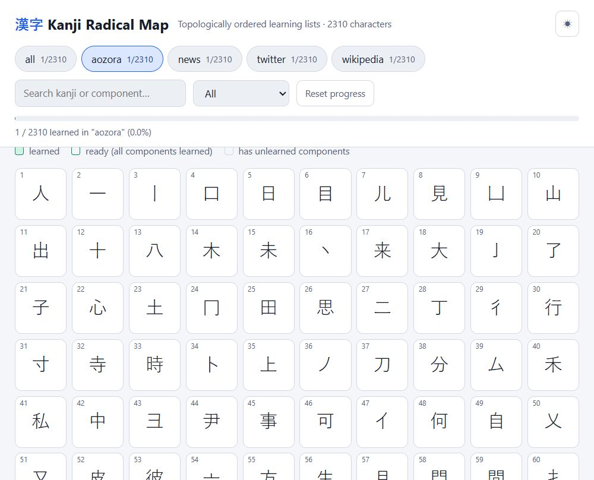
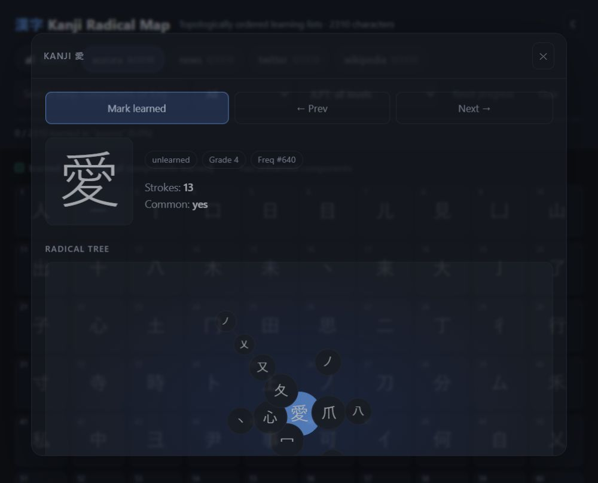

<p align="center">
  
</p>

<h1 align="center">漢字 Kanji Radical Map</h1>

<p align="center">
  <b>Master Japanese kanji the way they're actually built — one component at a time.</b>
</p>

<p align="center">
  <a href="#license"></a>
  
  
  <a href="https://vercel.com/new/clone?repository-url=https%3A%2F%2Fgithub.com%2Fshubham-101%2FKanji-Radical-Map"></a>
</p>

---

> **30 seconds, and you'll know why this works:**
>
> It is best to learn kanji starting from simple characters and then learn complex ones as
> compositions of smaller "parts" — radicals and components.
>
> - 一 → 二 → 三
> - 丨 → 凵 → 山 → 出
> - 言 → 五 → 口 → 語
>
> It is also smart to learn the most common kanji first.
>
> Kanji Radical Map orders all ~2,300 characters you need exactly that way: **no kanji
> appears before its components, and more frequent kanji come earlier.** Built on
> [TopoKanji][topokanji] by Dmitry Shpika, extended with an interactive web viewer and a
> full dictionary.

<table>
  <tr>
    <td align="center"></td>
    <td align="center"></td>
  </tr>
  <tr>
    <td align="center"><sub><b>2,310 kanji</b> in perfect component order, color-coded by progress</sub></td>
    <td align="center"><sub><b>Meaning, readings, words and sentences</b> — one popup per kanji</sub></td>
  </tr>
</table>

## ✨ Features

- 🧭 **Component-first learning order** — a topological sort of the radical graph of ~2,310 kanji ([algorithm](#how-it-works))
- 📈 **Frequency-aware** — five lists (`aozora`, `news`, `twitter`, `wikipedia`, `all`) ordered by real-world usage, so you learn what you'll actually see
- 🧩 **Interactive viewer** — click any kanji for components, usage, meaning, readings, mnemonics, related words and example sentences
- 🔎 **Search & filter** — jump to any kanji by character or component; filter by Learned / Unlearned / Ready or by JLPT level
- ✅ **Progress tracking** — mark characters learned, persisted in your browser; ready-to-learn highlighting
- 🌙 **Dark & light themes**, fully keyboard-navigable, accessible (ARIA roles, focus trapping, reduced-motion support)
- 📦 **Self-contained** — `index.html` ships the entire app and data; works offline, no server or build needed

## 🚀 Quick start

**No build required.** The viewer is committed to the repository.

```powershell
git clone https://github.com/shubham-101/Kanji-Radical-Map.git
```

Open **`index.html`** in your browser. That's it.

### Rebuild the viewer

```powershell
npm install
npm run build    # regenerate lists from data (node build.js save)
npm run viewer   # regenerate index.html from the lists + dictionary
```

### Rebuild the dictionary data

```powershell
npm run dictionary   # downloads KANJIDIC2/JMdict (EDRDG, CC BY-SA) and builds data/external/dictionary.json
```

Requires Python 3. The raw downloads (~250 MB) are git-ignored and re-fetched on demand; only the reduced `dictionary.json` is committed.

## ⌨️ Keyboard shortcuts

| Key | Action |
| --- | --- |
| `←` / `→` | Move one kanji in the list |
| `↑` / `↓` | Move up / down a row of the grid |
| `Home` / `End` | Jump to first / last kanji |
| `Enter` / `Space` | Select a kanji (open its details) |
| `M` | Mark the selected kanji learned |
| `Tab` / `Shift+Tab` | Move focus (trapped inside the popup while it's open) |
| `Esc` | Close the popup |

## 📚 The lists

Each list covers **2,310 characters** — radicals included, Jōyō-scale coverage.

| List | Ordered by | Coverage |
| --- | --- | --- |
| `aozora` | kanji in Japanese fiction/non-fiction | 95.89% |
| `news` | kanji in online news | 99.54% |
| `twitter` | kanji in Twitter messages | 99.07% |
| `wikipedia` | kanji in Wikipedia articles | 98.80% |
| `all` | combined average (experimental) | 98.33% |

### First 100 kanji from `aozora`

    人一丨口日目儿見凵山
    出十八木未丶来大亅了
    子心土冂田思二丁彳行
    寸寺時卜上丿刀分厶禾
    私中彐尹事可亻何自乂
    又皮彼亠方生月門間扌
    手言女本乙气気干年三
    耂者刂前勹勿豕冖宀家
    今下白勺的云牛物立小
    文矢知入乍作聿書学合

## 🔍 How it works

A kanji like 語 is three parts: 言, 五, 口 — which are kanji themselves. The lists are built so that every kanji appears **after** all of its components (a [topological ordering][topsort] of the DAG of component relationships) and **heavier (rare) kanji come later**. Learn top to bottom and you will never meet a component you don't know yet.

The ordering is computed with a modified [Kahn (1962)][kahn] algorithm with an intermediate frequency-based sort. Characters come from [KanjiVG][] (stroke data) and are decomposed with [CJK Decompositions Data][cjk], with hand-tuned overrides.

<details>
<summary><b>Tables and tuning rules (upstream)</b></summary>

### Which kanji are (not) included?

Kanji list covers about 95–99% of kanji found in various Japanese texts. Generally, the goal is to provide something similar to [Jōyō kanji][jouyou], but based on actual data. Radicals are also included, but only those which are parts of some kanji in the list.

Kanji/radical must **NOT** appear in this list if it is:

- not included in the KanjiVG character set
- primarily used in names (people, places, etc.) or in some specific terms (religion, mythology, etc.)
- mostly used because of its shape, e.g. a part of text emoticons/kaomoji like `( ^ω^)个`
- a part of a popular meme, manga/anime/dorama/movie title, #hashtag, etc.

### Statistical data

Frequency tables are derived from raw texts; see [kanji-frequency][kanji-frequency] for how they were collected.

</details>

## 🛠️ Command-line reference

```powershell
node build.js show                          # print the ordered lists
node build.js show --freq-table=aozora      # only one list (aozora, news, twitter, wikipedia, all)
node build.js show --per-line=50            # line width
node build.js coverage                      # coverage of each frequency table
node build.js save                          # regenerate lists + dependencies
node build.js suggest-add --num=20          # suggest kanji to add
node build.js suggest-remove --num=20        # suggest kanji to remove
npm run viewer                              # rebuild index.html
npm run dictionary                           # rebuild dictionary data (Python 3)
```

<details>
<summary><b>Repository layout & file formats</b></summary>

### `lists/`

- `*.txt` — final lists, one character per line (CSV/TSV-compatible)
- `*.json` — same as JSON arrays
- UTF-8 without BOM, `LF` line endings

### `dependencies/`

"Dependency" = a component of a kanji.

- `1-to-1.txt` — `tsort`-compatible: first character is the target, second is its dependency (`0` = none)
- `1-to-1.json`, `1-to-N.txt`, `1-to-N.json` — all of a kanji's components at once

### `data/`

- `kanji.json` — `[character, strokeCount, isCommon]` per entry
- `kanjivg.txt` — characters present in KanjiVG
- `cjk-decomp-{VERSION}.txt`, `cjk-decomp-override.txt` — decomposition sources and overrides
- `kanji-frequency/*.json` — usage frequency tables
- `external/dictionary.json` — merged meanings, readings, words, examples ([attribution](data/external/ATTRIBUTION.md))

### Restrictions on `data/kanji.json`

- No duplicates
- Each character must be in `kanjivg.txt`
- Each character must appear exactly once on the left-hand side of one line in `cjk-decomp-{VERSION}.txt`
- Each character *may* appear in `cjk-decomp-override.txt` (used to fix upstream records)

</details>

## 🌐 Deploy your own

This repository is a fully static site. Click the button (or import the repo manually at <https://vercel.com/new>):

[](https://vercel.com/new/clone?repository-url=https%3A%2F%2Fgithub.com%2Fshubham-101%2FKanji-Radical-Map)

A `vercel.json` is included: build command `node build-viewer.js`, output `.` (the root, serving `index.html`). No environment variables, no serverless functions, no build dependencies.

## 🙏 Credits & data sources

This project would not exist without its upstream:

- **[TopoKanji][topokanji]** — the original lists, algorithm, and all data pipelines, by **Dmitry Shpika** (MIT-compatible multi-license).
- **[JLPT/kanji-keys][kanji-keys]** — mnemonic keywords, by the same author.
- **[KanjiVG][]** — kanji shapes and stroke order.
- **[CJK Decompositions Data][cjk]** — component decomposition.
- **KANJIDIC2 / JMdict** — meanings, readings and compound words (Electronic Dictionary Research and Development Group, **CC BY-SA 4.0**), via the pre-built releases at [scriptin/jmdict-simplified][jmdict-simplified].
- **[Tatoeba][tatoeba]** — example sentences (**CC BY-SA 2.0 FR**), embedded in JMdict's example-sentence data (`source: "tatoeba"`).

The JLPT filter uses KANJIDIC2's `misc.jlptLevel` — the legacy 4-level scale published by EDRDG (Level 4 = basic/easiest, roughly N5–N4; Level 1 = advanced, roughly N1). Levels are labelled with their character counts; characters without a level are grouped under "unrated".

See [`data/external/ATTRIBUTION.md`](data/external/ATTRIBUTION.md) for the full attribution and license notes. If you redistribute the bundled dictionary data, keep the attribution and respect CC BY-SA share-alike.

## 📜 License

This is a multi-license project. Choose any license from this list:

- [Apache-2.0](http://www.apache.org/licenses/LICENSE-2.0) or any later version
- [CC-BY-4.0](http://creativecommons.org/licenses/by/4.0/) or any later version
- [EPL-1.0](https://www.eclipse.org/legal/epl-v10.html) or any later version
- [LGPL-3.0](http://www.gnu.org/licenses/lgpl-3.0.html) or any later version
- [MIT](http://opensource.org/licenses/MIT)

Note: the dictionary data bundled in `index.html` / `data/external/dictionary.json` is **CC BY-SA 4.0** — keep attribution and share alike when redistributing it.

[topokanji]: https://github.com/scriptin/topokanji
[kanji-keys]: https://github.com/scriptin/kanji-keys
[jmdict-simplified]: https://github.com/scriptin/jmdict-simplified
[tatoeba]: https://tatoeba.org
[mistakes]: http://www.tofugu.com/2010/03/25/the-5-biggest-mistakes-people-make-when-learning-kanji/
[graph]: https://en.wikipedia.org/wiki/Graph_(mathematics)
[topsort]: https://en.wikipedia.org/wiki/Topological_sorting
[kahn]: http://dl.acm.org/citation.cfm?doid=368996.369025
[wiki-dumps]: https://dumps.wikimedia.org/
[jouyou]: https://en.wikipedia.org/wiki/J%C5%8Dy%C5%8D_kanji
[kangxi]: https://en.wikipedia.org/wiki/Kangxi_radical
[kanjivg]: http://kanjivg.tagaini.net/
[kanjivg-github]: https://github.com/KanjiVG/kanjivg
[cjk]: https://cjkdecomp.codeplex.com/
[json]: http://json.org/
[kanji-frequency]: https://github.com/scriptin/kanji-frequency
